<div align="center">

# MediQueue

**A hospital OPD queue, appointment and token management system**

[](https://react.dev/)
[](https://vitejs.dev/)
[](https://supabase.com/)
[](https://vercel.com/)
[](#license)

[Live Demo](https://mediqueue-inky.vercel.app) &nbsp;•&nbsp; [Features](#features) &nbsp;•&nbsp; [Screenshots](#screenshots) &nbsp;•&nbsp; [Architecture](#architecture) &nbsp;•&nbsp; [Getting Started](#getting-started)

</div>

---

## Overview

Outpatient departments in most hospitals still run on physical tokens and manual queue management. Patients wait without knowing how long is left, and staff have no digital record of a visit until it is written on paper.

MediQueue digitizes that entire flow. A patient books an appointment for a department, doctor and date, receives a QR-coded token, and tracks the live queue. At the hospital, staff scan the token at the entry gate, doctors pull up the patient's history and record the visit digitally, and prescriptions are routed straight to the pharmacy counter.

The project started as an Express + MySQL application and was later migrated to **React + Supabase**, with security moved into the database layer (Row Level Security) and a serverless deployment on Vercel.

> **Live demo:** https://mediqueue-inky.vercel.app

## Features

- **Authentication**: email/password, Google Sign-In and password reset, with role-based access for Patient, Doctor, Pharmacy Staff and Admin.
- **Appointment booking**: book by department, doctor and date, with per-doctor daily token limits and availability checks.
- **QR token system**: every booking generates a unique, date-scoped QR token used for entry verification. Tokens can be printed or cancelled.
- **Live queue display**: a "now serving" board per department that updates in real time, with a polling fallback.
- **Entry gate scanner**: scan a patient's QR token with the device camera to verify entry.
- **Doctor panel**: scan or enter a token, view the patient's visit history, and record diagnosis and prescription.
- **Digital OPD card**: a persistent health record carried across every visit.
- **Pharmacy module**: manage medicine stock and move prescriptions through pending, preparing and ready states. Patients can check medicine availability before visiting.
- **Admin panel**: manage staff accounts, departments (icon, room, floor), doctors and daily token limits, with a live overview of the day's queue.

### Booking rules

Tokens open at 12:00 AM the day before the appointment date. A date can be booked from tomorrow onwards, up to one month in advance, and the last booking time for any date is 12:00 PM (noon) on that date.

## Screenshots

<table>
<tr>
<td width="33%">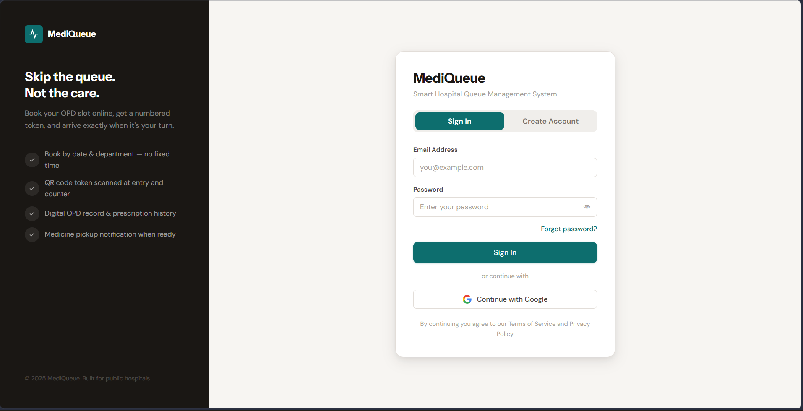<br/><sub>Login / Sign up</sub></td>
<td width="33%">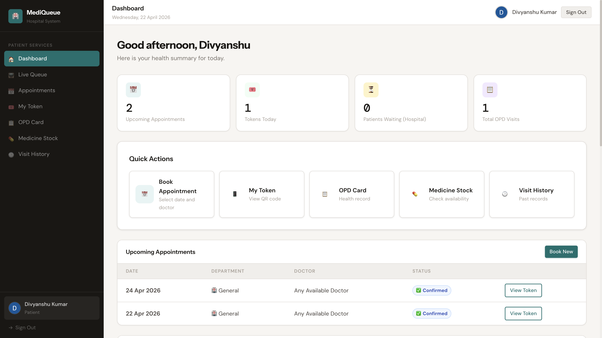<br/><sub>Patient dashboard</sub></td>
<td width="33%">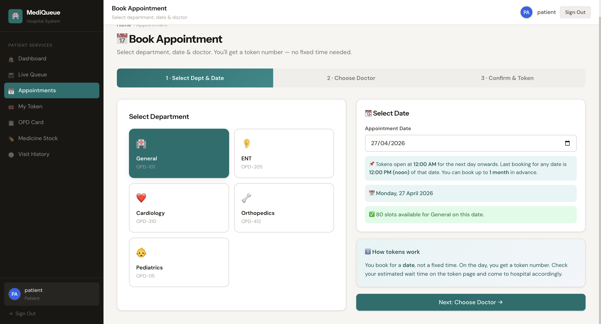<br/><sub>Book appointment: department and date</sub></td>
</tr>
<tr>
<td width="33%">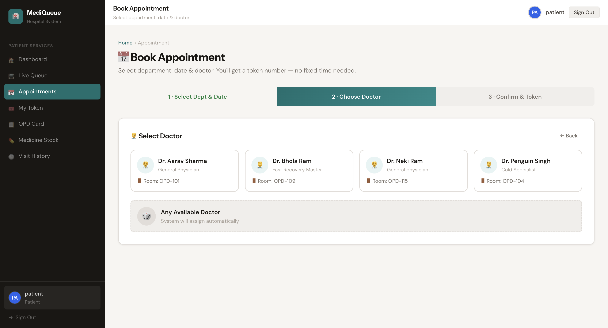<br/><sub>Book appointment: choose doctor</sub></td>
<td width="33%">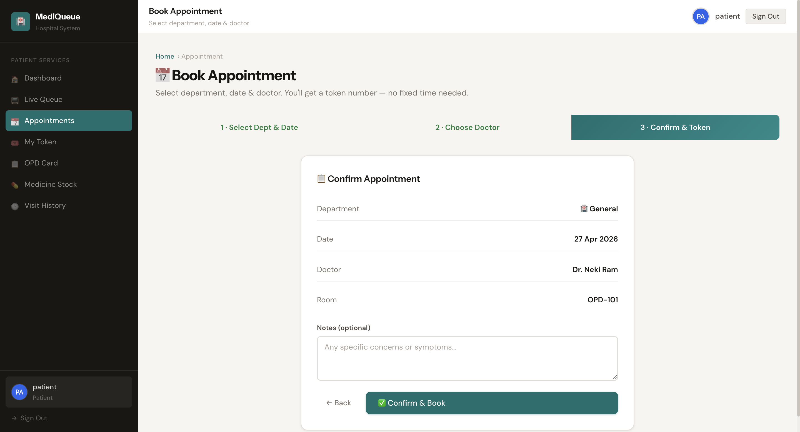<br/><sub>Book appointment: confirm and get token</sub></td>
<td width="33%">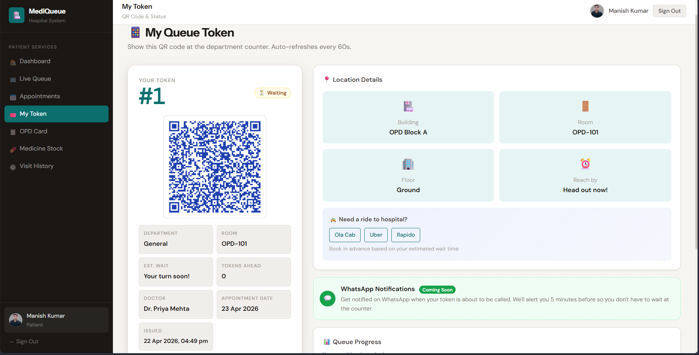<br/><sub>QR token with live queue status</sub></td>
</tr>
<tr>
<td width="33%">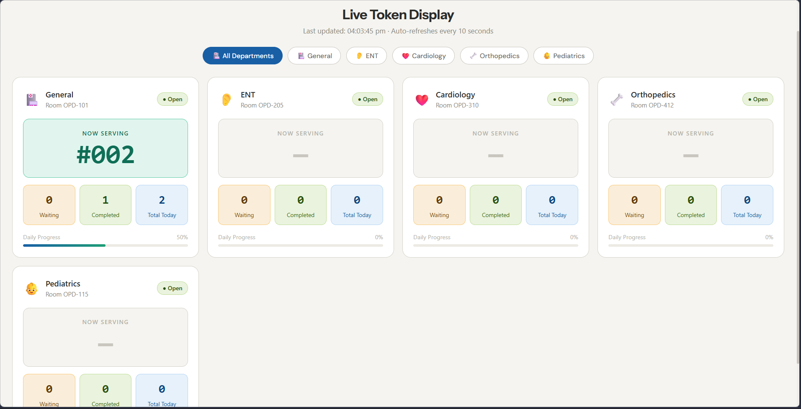<br/><sub>Live "now serving" queue display</sub></td>
<td width="33%">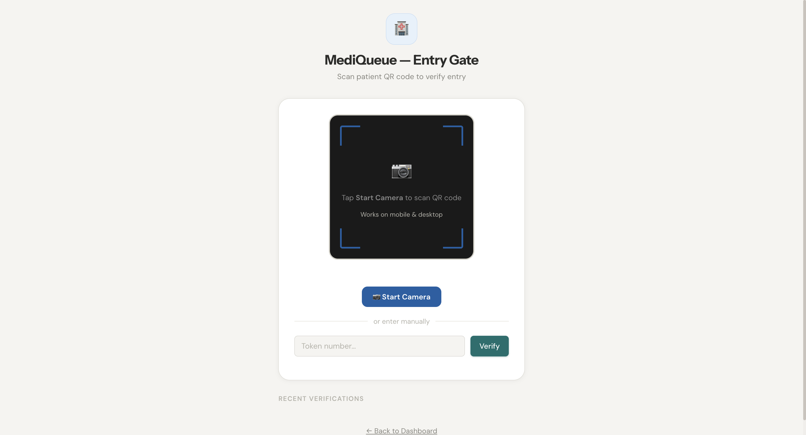<br/><sub>Entry gate: QR verification</sub></td>
<td width="33%">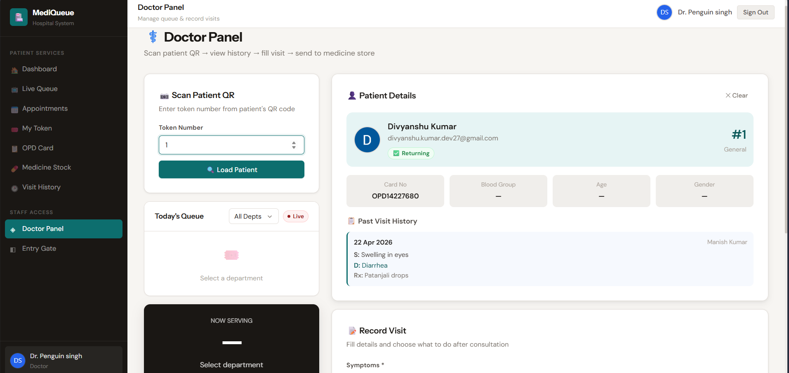<br/><sub>Doctor panel: patient history and visit entry</sub></td>
</tr>
<tr>
<td width="33%">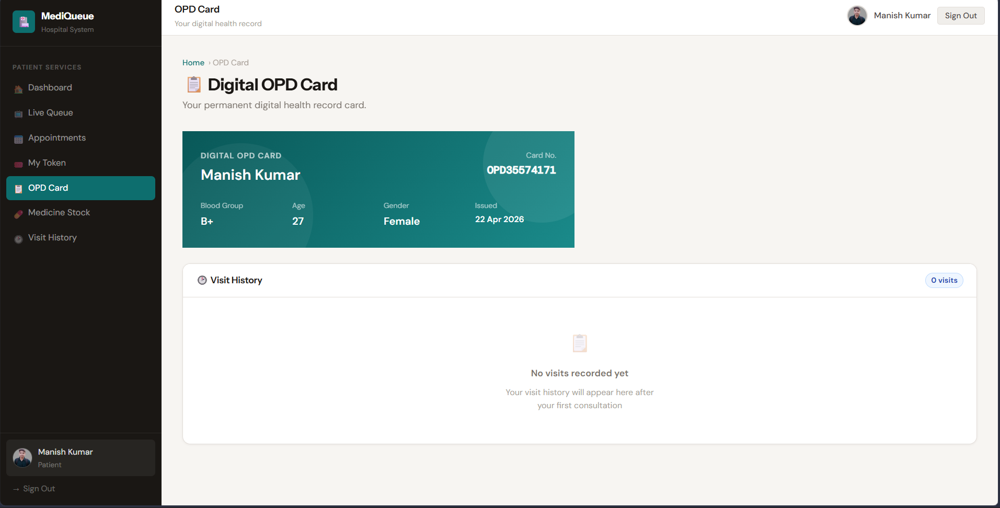<br/><sub>Digital OPD card</sub></td>
<td width="33%">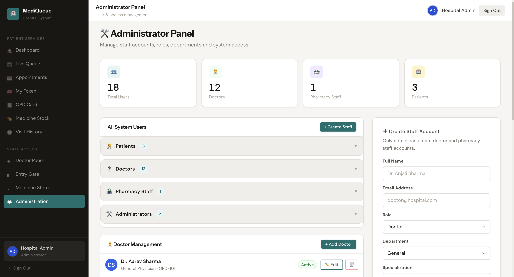<br/><sub>Admin panel: staff and access management</sub></td>
<td width="33%">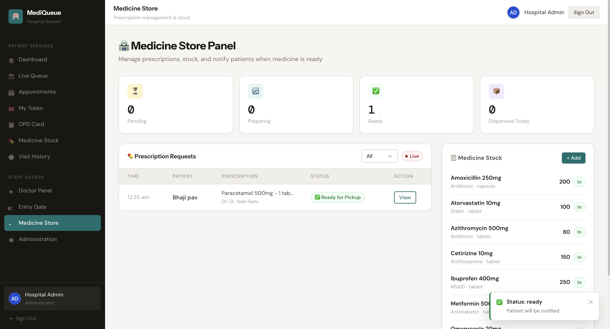<br/><sub>Pharmacy: prescription queue and stock</sub></td>
</tr>
</table>

## Architecture

```
React (Vite) SPA  ──►  Supabase JS client  ──►  Postgres + Auth + Realtime
   hosted on Vercel                              (Row Level Security on every table)
```

There is no custom backend server. The browser talks to Supabase directly, and all authorization is enforced inside the database.

### Highlights

- **Row Level Security everywhere.** Every table has RLS policies, roles are enforced in the database, profile `role` and `active` columns are protected, and public signup can never create an admin.
- **Race-safe booking.** Token numbers and capacity checks run inside SQL functions with advisory locks, so concurrent bookings cannot produce duplicate tokens.
- **Timezone-correct.** The hospital day is fixed to `Asia/Kolkata` in both the database and the UI, which avoids UTC/IST date mismatches.
- **Realtime updates.** The queue board, token page and pharmacy view update live, with a polling fallback.
- **Resilient UI.** Lazy-loaded routes, an error boundary, and a setup notice when environment variables are missing.

### Roles

| Role | How it is created | Access |
|---|---|---|
| `patient` | Self signup | Book appointments, view token, OPD card, history, medicine availability |
| `doctor` | Created by admin | Doctor panel, patient history, prescriptions |
| `medicine_staff` | Created by admin | Pharmacy panel, stock and prescription status |
| `admin` | Promoted via SQL | Everything above plus staff, departments and settings |

## Tech Stack

| Layer | Technology |
|---|---|
| Frontend | React 18, React Router 6, Vite 5 |
| Backend | Supabase (PostgreSQL, Auth, Realtime, Row Level Security, SQL functions) |
| Authentication | Supabase Auth: email/password, Google OAuth |
| QR | `qrcode` (generation), `jsQR` (camera scanning) |
| Hosting | Vercel (frontend), Supabase (backend), both on free tiers |

## Project Structure

```
mediqueue/
├── public/                  Static assets
├── src/
│   ├── components/          Layout, ProtectedRoute, ErrorBoundary, Badges, SetupNotice
│   ├── context/             Auth, Departments and UI providers
│   ├── hooks/               useQrScanner, useQueueStatus, useMediaQuery
│   ├── lib/                 Supabase client, routes, utilities
│   ├── pages/               Login, Dashboard, Appointment, Token, QueueDisplay,
│   │                        EntryScan, DoctorPanel, Opd, History, Medicines,
│   │                        MedicineAdmin, AdminPanel, ResetPassword
│   ├── services/api.js      Data access layer over Supabase
│   ├── styles/              Global styles
│   ├── App.jsx
│   └── main.jsx
├── supabase/
│   └── schema.sql           Tables, RLS policies, functions and seed data
├── vercel.json              SPA routing
├── vite.config.js
└── .env.example
```

## Getting Started

### Prerequisites

- Node.js 18 or later
- A free [Supabase](https://supabase.com) account

### 1. Clone the repository

```bash
git clone https://github.com/Divyanshukumar2005/MediQueue-Hospital-Management-System.git
cd MediQueue-Hospital-Management-System
```

### 2. Set up Supabase

1. Create a new project at [supabase.com](https://supabase.com).
2. Open **SQL Editor**, paste the full contents of `supabase/schema.sql` and run it. It creates all tables, security policies and functions, and seeds demo data (5 departments, 6 doctors, 8 medicines). It is safe to re-run.
3. Go to **Authentication → Providers → Email** and turn **Confirm email** off. This lets an admin create staff accounts that can log in immediately.
4. *(Optional)* Enable **Google** under Providers with your OAuth client ID and secret. The redirect URI to register in Google Cloud is `https://<your-project>.supabase.co/auth/v1/callback`.
5. Copy the **Project URL** and the **anon / publishable key** from **Project Settings → API Keys**.

> Only use the anon (publishable) key in the frontend. Never expose the `service_role` or secret key.

### 3. Configure environment variables

```bash
cp .env.example .env
```

```env
VITE_SUPABASE_URL=https://your-project.supabase.co
VITE_SUPABASE_ANON_KEY=your-anon-key
```

### 4. Run locally

```bash
npm install
npm run dev
```

Open http://localhost:5173.

### 5. Create the first admin

Sign up once in the app, then promote that account in the Supabase SQL Editor:

```sql
update public.profiles set role = 'admin' where email = 'you@example.com';
```

Log out and log in again. The Admin panel can now create doctor and pharmacy accounts.

## Deployment

The app is deployed on **Vercel**:

1. Import the GitHub repository into Vercel. The Vite preset is detected automatically.
2. Add the environment variables `VITE_SUPABASE_URL` and `VITE_SUPABASE_ANON_KEY`.
3. Deploy. `vercel.json` handles single-page-app routing.
4. In Supabase, go to **Authentication → URL Configuration**, set **Site URL** to your Vercel URL, and add the Vercel URL and `http://localhost:5173` to **Redirect URLs**. This is required for password reset and Google login.

> Supabase free projects pause after a period of inactivity. If the live demo does not load, open the Supabase dashboard and resume the project.

## Migration Notes

This project began as a Node.js, Express and MySQL application (Render + Aiven). The migration to React and Supabase brought:

| Area | Before | After |
|---|---|---|
| Frontend | Vanilla HTML/CSS/JS | React 18 with routing and lazy-loaded pages |
| Backend | Express + Sequelize + MySQL on a server that sleeps | Supabase Postgres, no server to keep awake |
| Authorization | Application-level JWT checks | Row Level Security enforced in the database |
| Booking | Application logic | SQL functions with advisory locks |
| Additions | | Password reset, Google sign-in, soft-cancel tokens, QR print, department editor, live admin overview |

The previous implementation remains available in the repository's git history.

## License

Released under the MIT License.

---

<div align="center">

Built by [Divyanshu Kumar](https://github.com/Divyanshukumar2005)

</div>
